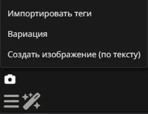

# 🚀 NoPaywall_AI_Roleplay: Uncensored Local AI Roleplay & Generation

**This stack was created out of sheer frustration with paid services that charge exorbitant monthly fees for basic roleplay and image generation, while censoring NSFW content.**

This is a fully autonomous, free, and uncensored alternative. You own the hardware, you own the models, and you own the chat. No subscriptions, no corporate filters, no limits.

Optimized for mid-range GPUs (tested on **RTX 3070 Ti, 8GB VRAM**).

## ✨ Features: The `Ult_generation` Extension

This repository includes a custom-built SillyTavern extension (`Ult_generation`), specifically designed to bridge SillyTavern and ComfyUI seamlessly.

### 🖼️ Screenshots
*Here is how the extension menu looks in SillyTavern (mobile view):*

### Core Features
*   **🔍 Image Analysis (Import Tags):** Upload any reference image. The script extracts Danbooru tags via ComfyUI (using the DeepGelbooru model) and puts them into an editable field.
*   **🎨 Instant Variation:** Upload an image, and the script will extract tags and **immediately generate** a new image based on them.
*   **💬 Text-to-Image:** Create images purely from a text prompt, no reference needed.
*   **🧠 Automatic LoRA Loading:** The script detects the active character in SillyTavern and automatically finds the matching LoRA file in your ComfyUI `models/loras` folder. No manual selection required.
*   **📱 PC & Mobile Support:** Automatically detects the host IP address (`window.location.hostname`), allowing seamless use from both desktop and mobile browsers on the same local network.
*   **📸 In-Chat Image Insertion:** Uses the Base64 method (adapted from *Image Gen Kazuma*) to save generated images directly into SillyTavern's folder. This guarantees that images display correctly in the chat, even on mobile devices.

## 🛠️ The Stack (Why it's free)

*   **LLM Engine:** [Ollama](https://ollama.com/) running `Ministral-3-8B-Nymphaea-RP` (Q4_K_M). A powerful, uncensored model.
*   **Image Generation:** [ComfyUI](https://github.com/comfyanonymous/ComfyUI) running `WAI-NSFW-Illustrious-17`.
*   **Image Analysis:** `ImgUtilsDeepGelbooru` (via `comfyui-imgutils` custom node).
*   **User Interface:** [SillyTavern](https://github.com/SillyTavern/SillyTavern).
*   **Control:** A custom Python Telegram bot manages the start/stop scripts, allowing you to run the AI from your phone.

## 🚀 Installation

1.  **Clone this repository** or download it as a ZIP.
2.  **SillyTavern Extension:** Place the `Ult_generation` folder into your SillyTavern directory:
    `SillyTavern/public/scripts/extensions/third-party/Ult_generation/`
3.  **ComfyUI Requirements:** Ensure you have installed the `comfyui-imgutils` plugin in your ComfyUI `custom_nodes` folder.
4.  **Scripts:** Place `start_all.bat`, `stop_all.bat`, `start_bot.bat`, and `start_bot.vbs` in your root AI folder (e.g., `E:\AI\`).
5.  **Telegram Bot:** Configure your bot token in the `ai_bot.py` script (or use environment variables).
6.  Restart SillyTavern. A **camera icon** (📷) will appear in the message input bar.

## ⚙️ Configuration

1.  Open the Extensions menu (puzzle icon 🧩) in SillyTavern and find **Ult_generation**.
2.  Enter your **ComfyUI URL** (e.g., `http://192.168.0.171:8188`). Do not use `127.0.0.1` if you plan to use a phone.
3.  Select your **Checkpoint** from the dropdown.
4.  Start ComfyUI with the `--listen` flag to accept mobile connections.

## 🌐 Disabling Auto-Translation (Important!)

If your browser (like Chrome or Yandex) automatically translates the page, it can break the SillyTavern interface and translate technical terms (like "Checkpoint" or "LoRA") into Russian, making it impossible to find the correct settings.

To prevent this:
1.  **In your browser settings**: Go to Settings -> Languages -> Disable "Offer to translate pages".
2.  **On the page**: If a translation bar appears at the top of the page, click "Options" (three dots) and select **"Never translate this site"**.
3.  **SillyTavern settings**: Inside SillyTavern, go to the User Settings (icon of a person) and set the Interface Language to **English** to ensure the extension buttons match the README instructions.

## 🎮 Managing the Stack (Start & Stop Scripts)

To make launching and closing the entire AI stack effortless, this repository includes two custom batch scripts. They are designed to be used either manually or remotely via the Telegram bot.

### 🟢 How `start_all.bat` works
This script is your one-click launcher. When executed, it performs the following steps:
1.  **Launch Ollama:** Starts the Ollama background service if it is not already running.
2.  **Launch ComfyUI:** Opens a new command prompt window and starts ComfyUI. It waits a few seconds to ensure the server initializes properly.
3.  **Launch SillyTavern:** Opens another command prompt window and starts the SillyTavern server.
4.  **Ready to Use:** Once all three windows are open, you can access SillyTavern in your browser and start chatting or generating images.

### 🔴 How `stop_all.bat` works
This script is designed for a safe and complete shutdown. It ensures that heavy AI processes are terminated to free up your GPU and RAM, but **it intentionally leaves your Telegram bot running** so you can still command the PC remotely. 
Here is what it does:
1.  **Stops Ollama:** Forcefully closes `ollama.exe` and `ollama app.exe`.
2.  **Stops SillyTavern:** Uses PowerShell to find the specific process occupying port `8000` and terminates it. It also scans for any remaining `SillyTavern` related processes to ensure a clean shutdown.
3.  **Stops ComfyUI:** Uses PowerShell to find the process occupying port `8188` and terminates it.
4.  **Cleans up Windows:** Closes any leftover command prompt windows with titles like "ComfyUI" or "SillyTavern".
5.  **Preserves the Bot:** It carefully avoids killing the `python.exe` process that runs `ai_bot.py`, keeping your remote control alive.

## 🙏 Credits & Acknowledgments

This project stands on the shoulders of giants. Special thanks to:

*   **DeepGelbooru Model:** Created by the [DeepGHS](https://deepghs.org/) community.
*   **Image Gen Kazuma:** The in-chat image insertion method (Base64 saving) was adapted from the [Image-gen-kazuma](https://github.com/Arif-salah/Image-gen-kazuma) extension by Arif-salah.
*   **SillyTavern & ComfyUI:** For providing the robust open-source platforms that make this stack possible.

## 📜 Licenses

This project uses components from various open-source projects. Please respect their licenses:

*   **My Custom Code (Extension & Scripts):** Licensed under the **MIT License**. See the [LICENSE](LICENSE) file for details.
*   **DeepGelbooru:** MIT License.
*   **Image Gen Kazuma:** MIT License.

## ❤️ Support the Project

If you find this stack useful and want to support my fight against paid, censored AI services, you can send a donation here:

*   **Boosty:** [https://boosty.to/wetlabac](https://boosty.to/wetlabac)
*   **Tribute:** [https://web.tribute.tg/e/1Pz](https://web.tribute.tg/e/1Pz)

Your support helps keep the project alive and free for everyone.
